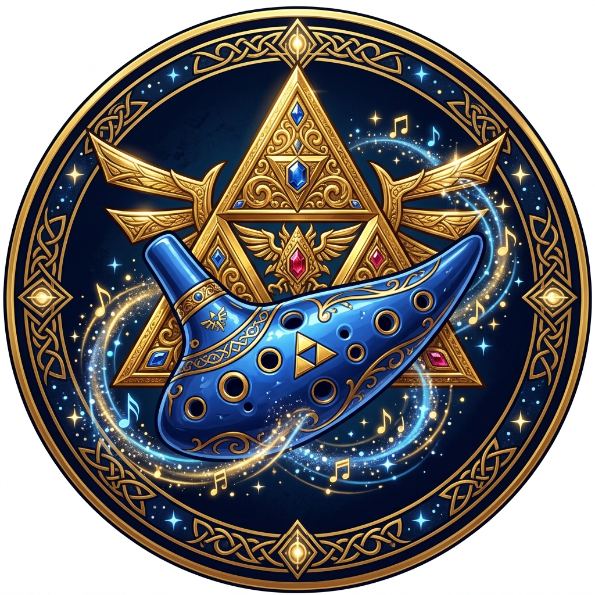
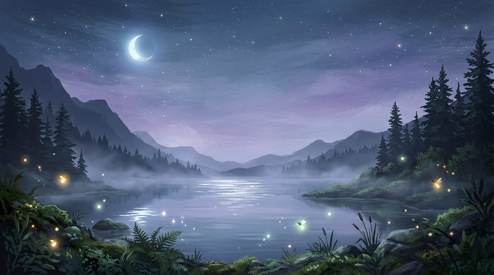
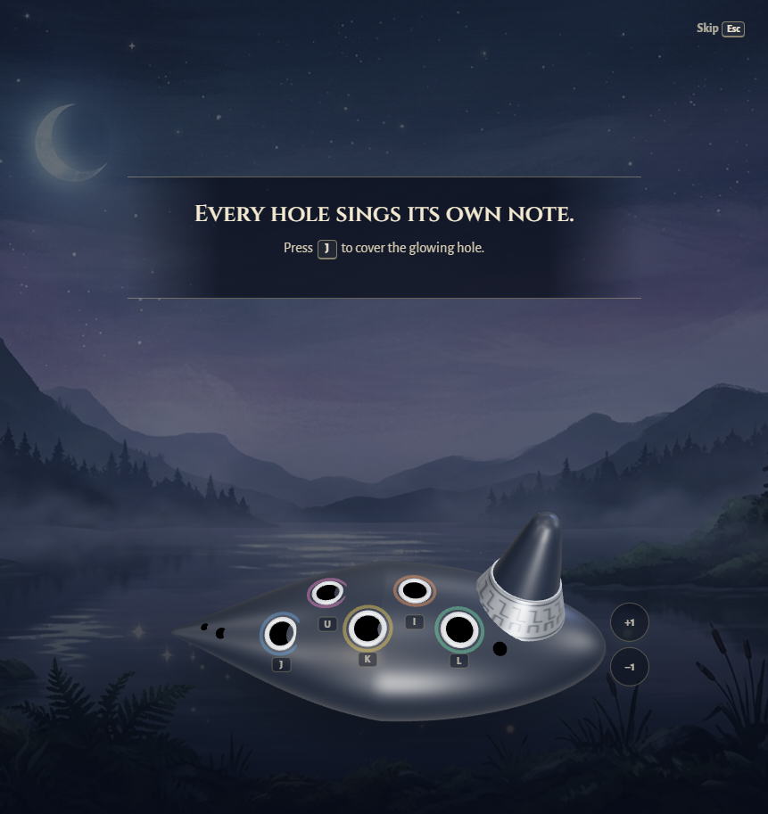
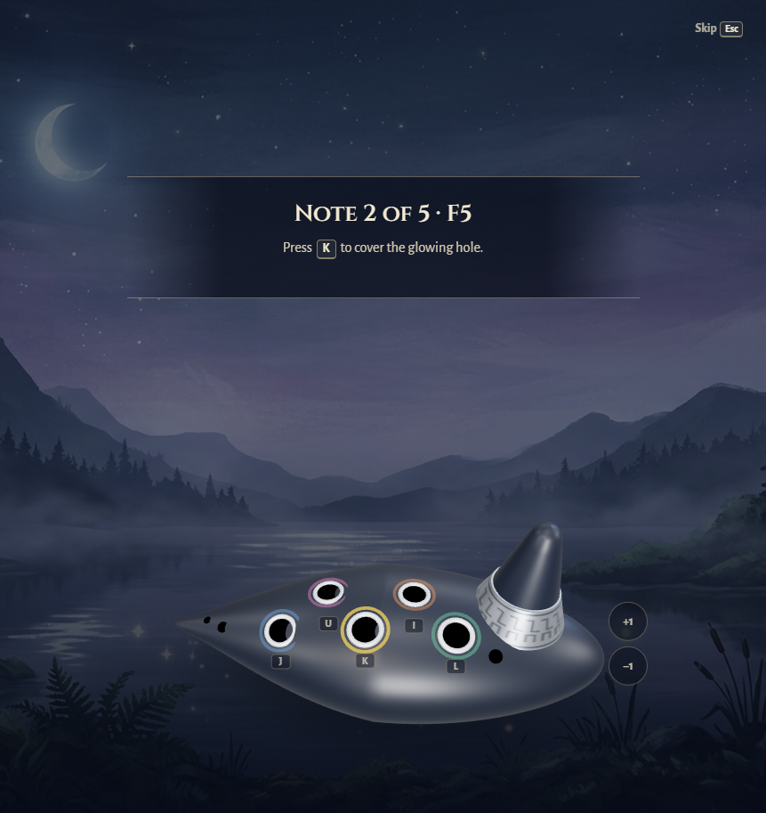
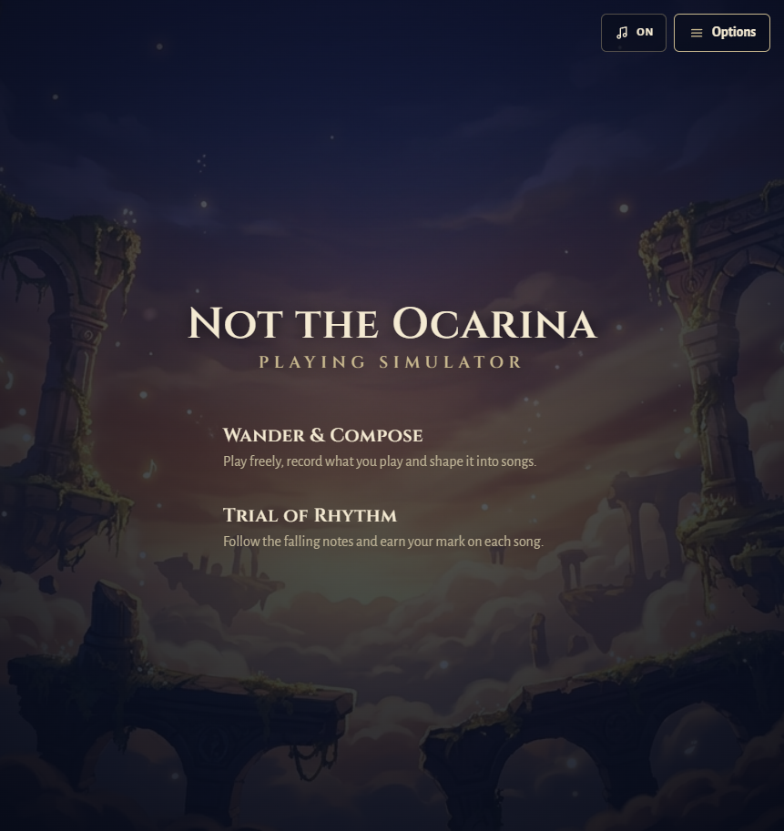

<div align="center">



# 🎵 Not The Ocarina Playing Simulator

**An open-source, 3D polyphonic Ocarina playground, partiture composer, and rhythm game — crafted with love for Zelda fans and ocarina players around the world.**

[](https://neobenjax.github.io/not-the-ocarina-playing-simulator/)
[](#)
[](CONTRIBUTING.md)



</div>

---

## 🌟 Welcome, Fellow Ocarina Travelers!

Whether you've been trying to summon a rainstorm with three notes since 1998 or you simply love the warm, breathy chime of a sweet-potato ocarina, **Not The Ocarina Playing Simulator** is your browser-based instrument, studio, and rhythm stage.

No cartridges, no plugins, and zero downloads required — just open the page, touch or tap your keyboard, and let the melodies fly!

---

## 🎓 How to Play & First-Run Tutorial

When you first enter the game (`Click or Press Any Key`), a gentle **interactive lesson** greets you and teaches you how the 5-hole transverse ocarina sings:

1. **Learn the 5 Holes**: Follow the glowing ring on the sculpted 3D Ocarina (`J`, `K`, `L`, `I`, `U` on desktop, or tap directly on touchscreens).
2. **Echo by Ear**: Repeat two short melodic phrases back to the instrument.
3. **Enjoy the Finale**: Once you've got the hang of it (or if you press `Esc` to skip), the ocarina plays its closing song and unlocks the Mode Selector.

<div align="center">
  
  
</div>

### 🎹 Controls at a Glance

| Action | Default Key | Touch / Mouse | Notes |
| :--- | :---: | :---: | :--- |
| **Hole A (`D5`)** | `J` | Tap `A` hole | Base low note |
| **Hole ▼ (`F5`)** | `K` | Tap `▼` hole | Lower-mid note |
| **Hole ▶ (`A5`)** | `L` | Tap `▶` hole | Mid-high note |
| **Hole ◀ (`B5`)** | `I` | Tap `◀` hole | High note |
| **Hole ▲ (`D6`)** | `U` | Tap `▲` hole | Top octave note |
| **Pitch Bend Up (`+1`)** | `↑` (`ArrowUp`) | Hold `▲ +1` | Raises pitch by +1 semitone |
| **Pitch Bend Down (`-1`)** | `↓` (`ArrowDown`) | Hold `▼ -1` | Lowers pitch by -1 semitone |
| **Blow Air (Breath Mode)** | `Space` | Hold `BLOW AIR` | Optional in Keys/Options |
| **Pause (Arcade)** | `Esc` | `⏸ Pause` | Freezes timer & opens pause menu |

> 💡 **Tip:** Every key binding is customizable under **Controls (`Keys`)**, and you can swap between 6+ ceramic finishes (or upload your own custom SVG mask) in **Finish (`Skins`)**!

---

## 🎮 Game Modes & Mechanics

<div align="center">
  
</div>

### 🎼 Mode 1 · Wander & Compose (Free Play & Composer)
A clean 50/50 split workspace with the 5-track partiture on top and the interactive 3D Ocarina stage below:
- **Polyphonic Synthesis & Chords**: Hold 2 or more holes at once and the Web Audio synthesizer blends their voices naturally — just like a real multi-chamber flute/ocarina!
- **Real-Time Long-Press Capture**: Hold a note longer and watch its duration pill stretch live across the timeline.
- **Pitch-Bending Notation**: Bent notes (`+1` / `-1` semitone) appear in the **upper half** or **lower half** of each lane.
- **DAW-Style Multi-Select**: `Ctrl+Click` to toggle notes or drag a **selection marquee** box to move, resize, or delete (`Delete` / `Supr`) multiple notes together.
- **Auto-BPM & Smooth Scroll**: Automatically calculates BPM from your playing rhythm (or set it manually), with `overlayscrollbars` for buttery horizontal scrolling.
- **Export & Share**: Save tracks to playlists, export real **`.mp3`** audio, or download/import universal plain-text **`.ocarina.txt`** partitures (supports both structured beat tables and inline arrow notation like `▼ ▼(Up) ◄ — ▲`).

### 🎯 Mode 2 · Trial of Rhythm (Arcade Mode)
- **Vertical Music Roller & Categories**: Browse built-in parody tunes (*Princess Nap Time*, *Windmill Weather Forecast*, *Never Gonna Give You Up (Chorus)*, *Darude - Sandstorm*, *All Star (Chorus)*, and more) or your own composed playlists.
- **Two Assist Modes**:
  - 🌱 **Novice**: Plays a soft guide melody so you can learn by ear.
  - 🔥 **Original**: Pure timing — the ocarina only sings when you hit the notes!
- **Game Feel & Long-Note Sustain**:
  - Visible **`GOOD` / `OK` / `BAD`** timing zones, `3-2-1` countdown, micro-hitstop, particle hit bursts, note pop animations, and a 3D miss-flick when you slip up.
  - Holding long notes triggers **Sustain State** with a glowing receptor beam, continuous sparks, body illumination, and combo/score ticks!
  - Top-center **Combo Banner** with hit-pop, 10-streak bursts, and combo-break shatter feedback.

---

## 🛠️ Running Locally

```bash
git clone https://github.com/neobenjax/not-the-ocarina-playing-simulator.git
cd not-the-ocarina-playing-simulator
npm install
npm run dev
```

To run the production build and Playwright E2E tests:
```bash
npm run typecheck
npm run build
npx playwright test
```

---

## 🤖 Credits & The Story Behind This Experiment

This project was born as a fun creative experiment powered by AI with **Gemini** and **Claude** — **all credits go to them** for generating the code, 3D geometry, procedural Web Audio synthesis, UI icons, backgrounds, and musical charts.

The only human contributions were direction, vision, and a healthy dose of *"whipping"* and burning through our weekly AI limits:
- **Benjamin** — *Idea, Game Modes & Dynamics*
- **Mauricio** — *Game Design Direction & Immersiveness*

---

## ⚖️ Disclaimer & Open Source

- **No Copyright Infringement Intended**: This unofficial ocarina simulator is **completely unaffiliated with Nintendo® or The Legend of Zelda™**.
- **Original & AI-Generated Assets**: All 3D models, SVG icons, backgrounds, synthesized ocarina tones, and parody song titles/charts are original or AI-generated — **no direct assets, ROMs, audio samples, or sprites from Nintendo®** are used in this repository.
- **Open Source**: This is an open-source fan project made for learning, music-making, and fun.

---

## 🤝 Community & Collaboration

Want to share a custom `.ocarina.txt` partiture, design a new ocarina finish, report a bug, or suggest a new game mode? We'd love to hear from you!

👉 Check out **[CONTRIBUTING.md](CONTRIBUTING.md)** to see how to reach out and collaborate.
